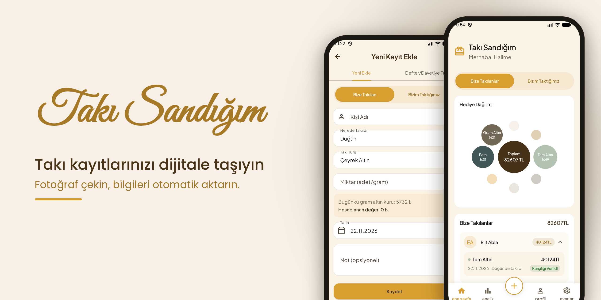
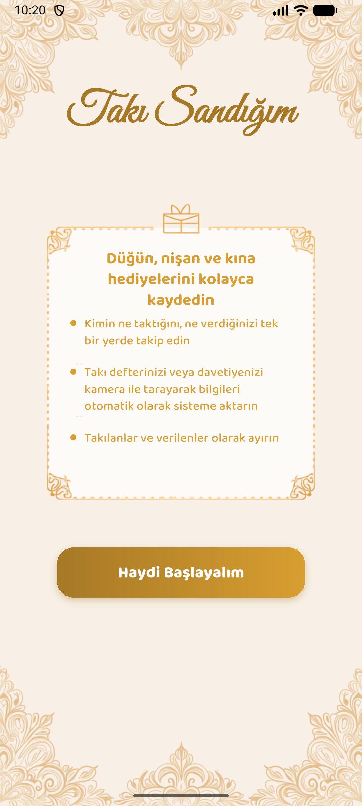
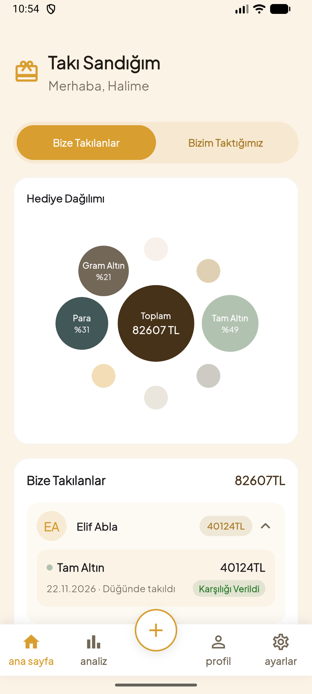
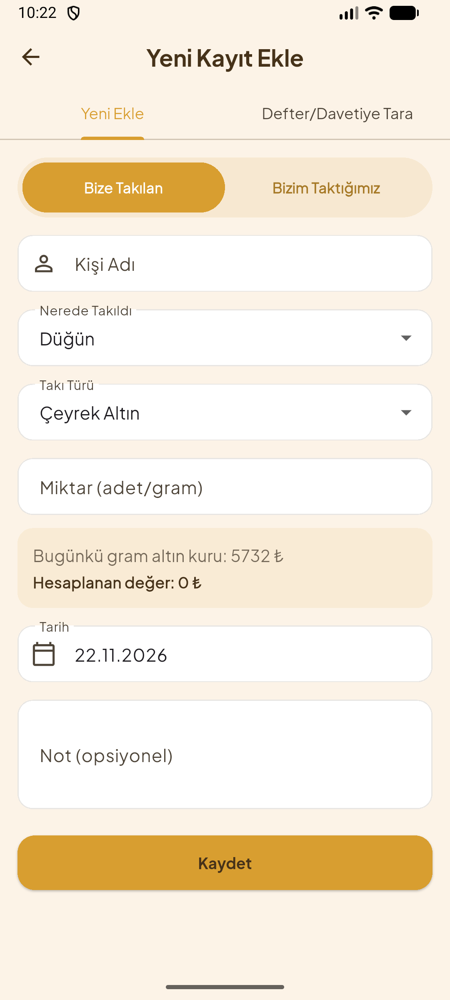
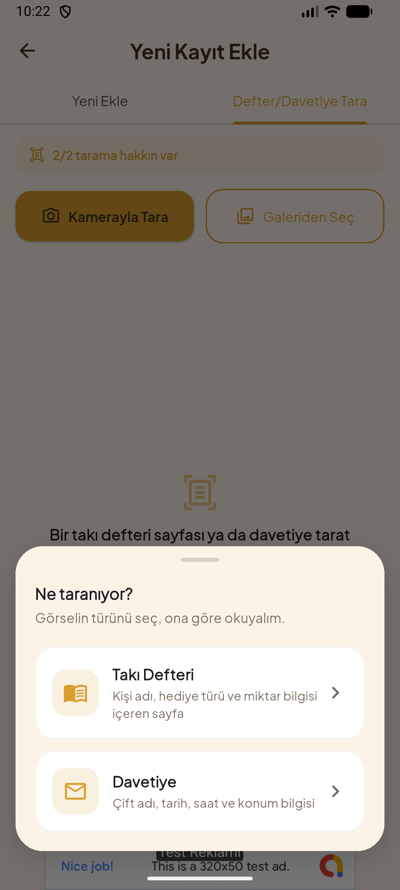
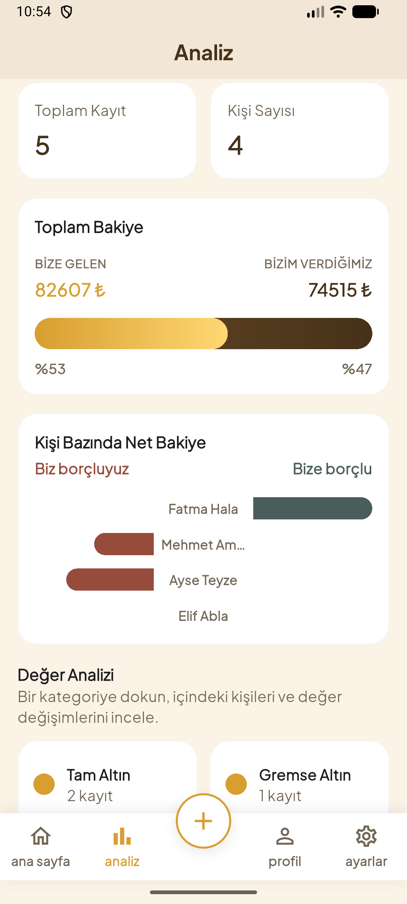
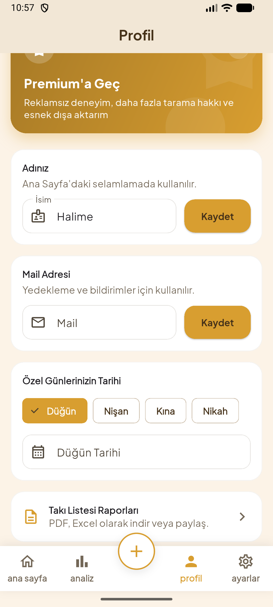
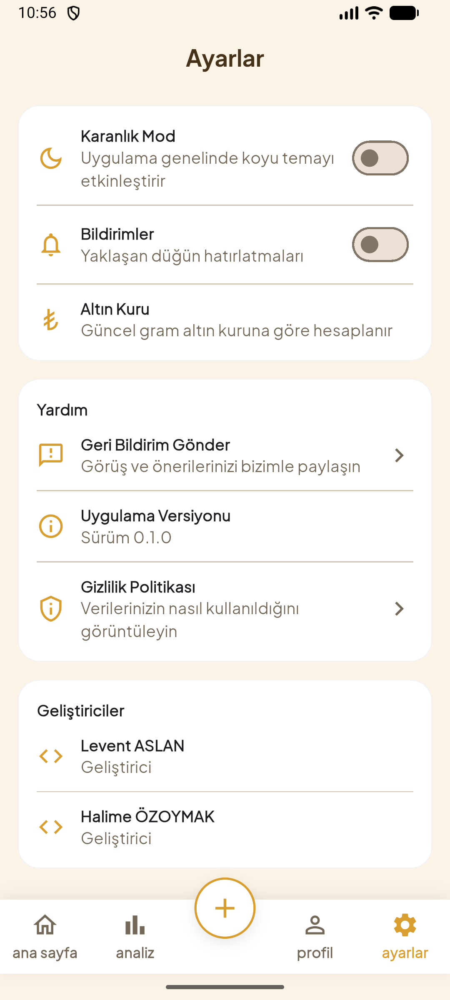

# Takı Sandığım



Düğün, nişan, kına ve nikah takı/hediyelerini takip etmeye yarayan bir Flutter uygulaması. Kimin ne taktığını, kime ne taktığınızı ve kimin kime borçlu olduğunu (altın, döviz veya nakit bazında) kaydeder; el yazısı defter sayfalarını kamerayla tarayıp OCR ile otomatik satır satır aktarabilir.

## Ekran Görüntüleri

| Karşılama | Ana Sayfa | Kayıt Ekle | Tarama |
|---|---|---|---|
|  |  |  |  |

| Analiz | Profil | Ayarlar |
|---|---|---|
|  |  |  |

## Özellikler

### Onboarding

- **Giriş ekranı** — uygulamayı tanıtan, "Haydi Başlayalım" butonlu ekran.
- **İsim alma ekranı** — `Size Nasıl Hitap Edelim?` başlıklı ekran.
- **Mail alma ekranı** — yedekleme için mail adresi isteyen, atlanabilir bir ekran; girilen mail kalıcı olarak saklanır.
- İsim daha önce kaydedilmişse uygulama her açılışta onboarding'i tekrar göstermez, doğrudan ana sayfaya yönlendirir.

### Ana Sayfa

- Kullanıcı adıyla karşılama, **Bize Takılanlar / Bizim Taktığımız** yön seçici.
- Takı türüne göre pasta grafikli bakiye özeti (her dilimin yazı rengi, dilim rengine göre otomatik kontrastlı seçilir).
- Kişi bazlı, açılır-kapanır toplam liste (her kişinin kendi hediyeleri detayda görünür).

### Takı Ekleme (`+` butonu)

- **Manuel ekleme** — yön, kişi, yakınlık derecesi, etkinlik türü (düğün/nişan/kına/nikah), takı türü ve tutar (gram altın türleri güncel gram altın kuruyla, ya da **TL/Döviz** seçenekli tutar güncel döviz kuruyla) girilir, tarih ve not eklenebilir.
- **Defter/Davetiye tarama** — kamerayla (kırpma çerçeveli) fotoğraf çekimi ya da galeriden seçim, ardından OCR ile satır satır otomatik ayrıştırma; her satır tek tek onaylanıp (Ekle/Atla) düzenlenebilir. Ücretsiz kullanımda günlük tarama hakkı sınırlıdır.

### Defterim (Ledger)

- Aranabilir, kişi bazlı, açılır-kapanır liste; her kişi kartında en son verilen/alınan hediye, toplam bakiye ve tüm kayıt geçmişi (silinebilir, onay dialoglu) gösterilir.

### Analiz

- Güncel gram altın kuru kartı, toplam kayıt/kişi sayısı istatistik kutuları.
- Bize gelen / bizim verdiğimiz donut grafiği, kişi bazında net bakiye bar grafiği (ilk 6 kişi).
- **Değer Analizi** — sabit bir kategori ızgarası (her altın türü + döviz için ayrı kutu, sürekli büyüyen bir liste yerine), kategoriye dokunulunca o kategorideki kişilerin aranabilir listesine gider.
- **Değer Analizi Detayı** — tek bir hediyenin o günkü değeri ile bugünkü değerini, değişim yüzdesini ve gün/hafta/ay/yıl/tümü seçenekli bir değişim grafiğini gösterir. Uç noktalar gerçek değerlerdir, aradaki çizgi doğrusal bir tahmindir (gerçek geçmiş kur verisi kullanılmaz).

### Profil

- Profil fotoğrafı (galeriden seçim), isim/mail güncelleme, düğün/nişan/nikah/kına seçimiyle "Özel Günlerinizin Tarihi" belirleme.
- Takı listesini metin özeti olarak paylaşma.
- **Raporlar** ekranına yönlendiren kart.
- **Çıkış Yap** ve **Hesabı Sil** — uygulamada sunucu tabanlı bir hesap sistemi olmadığından, bu işlemler tamamen cihaz üzerindeki yerel Hive verisini hedefler. 

### Premium

- Reklamsız kullanım
- Daha fazla tarama hakkı
- Esnek dışa aktarma seçenekleri

### Raporlar

- **PDF**, **Excel (CSV)** dışa aktarma ve **Paylaş** — her satırın kendi bağımsız yükleniyor durumu vardır, biri işlemdeyken diğerleri etkilenmez; paylaşım penceresi açılmazsa 20 saniye sonra zaman aşımına uğrar.

### Ayarlar

- **Karanlık Mod** — anahtar ile açılıp kapanır, tercih Hive'da saklanır, tüm uygulama kabuğunu etkiler. Soluk/ikincil yazı rengi karanlık modda ayrı bir tonla okunaklı kalacak şekilde tasarlanmıştır.
- **Bildirimler** açma/kapama anahtarı.
- Güncel gram altın kuru bilgi satırı.
- **Yardım** — Geri Bildirim Gönder, Uygulama Versiyonu, Gizlilik Politikası.
- **Geliştiriciler** — Levent ASLAN ve Halime ÖZOYMAK bilgileri.

### Dil Desteği

Türkçe ve İngilizce dillerini destekler.

## Rotalar

| Route | Ekran |
|---|---|
| `/onboarding` | OnboardingScreen |
| `/onboarding/name` | NameEntryScreen |
| `/onboarding/email` | EmailEntryScreen |
| `/` | DashboardScreen |
| `/ledger` | LedgerScreen |
| `/analytics` | AnalyticsScreen |
| `/profile` | ProfileScreen |
| `/settings` | SettingsScreen |
| `/add-gift` | AddGiftScreen |
| `/reports` | ReportsScreen |
| `/gift-value-analysis` | GiftValueAnalysisScreen |
| `/value-analysis` | ValueAnalysisListScreen |

## Geliştirme

```bash
flutter pub get
flutter pub run build_runner build --delete-conflicting-outputs
flutter run
```

`GiftModel`, `WeddingModel` veya enum'lara yeni alan eklendiğinde `build_runner` yeniden çalıştırılmalı; mevcut `@HiveField(n)` indeksleri asla değiştirilmemelidir — yeni alanlar her zaman bir sonraki boş indeksi kullanmalıdır.

Daha kapsamlı teknik dokümantasyon için [`PROJECT_OVERVIEW.md`](PROJECT_OVERVIEW.md) dosyasına bakın.
